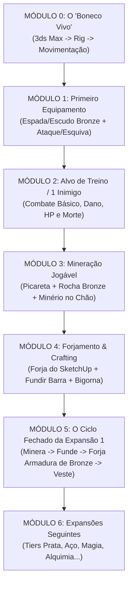

# 🗺️ PLANO DE IMPLEMENTAÇÃO EM FATIAS JOGÁVEIS (VERTICAL SLICES)
> **Projeto:** Dungeon Stance (The Pixel)  
> **Filosofia:** *"Cada etapa termina com algo 100% jogável e testável na tela."*

---

## 🎯 Visão Geral do Ciclo de Desenvolvimento
Em vez de modelar todos os 700+ assets para só então começar a programar o jogo, nós dividimos o projeto em **Módulos Jogáveis (Fatias Verticais)**.  
A regra de ouro é: **nunca crie mais de 3 itens sem testar o primeiro funcionando na mão do boneco.**

---

## 🟢 MÓDULO 0 — O "Boneco Vivo" (Base & Movimentação)
> **Meta Deste Módulo:** Entrar no jogo com o personagem masculino que você acabou de modelar no 3ds Max, andar pelo mapa em visão isométrica/top-down, correr e pular.

### Passo 0.1: Exportação Limpa do 3ds Max
- [X] Pegar o arquivo `base_male.max` (concluído com 4.530 polys).
- [X] Criar um esqueleto básico (Biped padrão ou Bones simples: Root, Pelvis, Spine, Chest, Neck, Head, Clavicle L/R, Arm L/R, Forearm L/R, Hand L/R, Thigh L/R, Calf L/R, Foot L/R).
- [ ] Criar dois **Sockets / Dummy Bones**:
  - `Socket_Weapon_R` (na palma da mão direita para prender espadas/picaretas).
  - `Socket_Weapon_L` (no antebraço esquerdo para escudos/tochas).
- [ ] Aplicar o modificador `Skin` no 3ds Max (ou rigging automático rápido).
- [ ] Exportar para `_Export_3dsMax_Final/Characters/SK_Hero_Male.fbx` (com smoothing groups ativos e escala em Centímetros / 1.0).

### Passo 0.2: As 3 Animações Essenciais
- [ ] **Idle (Parado respirando):** 30 a 60 frames em loop.
- [ ] **Run (Corrida com energia):** 24 a 30 frames em loop.
- [ ] **Jump / Dodge (Salto ou Rolamento):** 20 frames.
*(Dica: Se não quiser animar à mão agora, use o Mixamo ou o pipeline de IA descrito em `video_para_animacao.md` para puxar os 3 clipes em 10 minutos).*

### Passo 0.3: Teste Jogável 0 (Playable Test 0)
- [ ] Colocar o personagem num chão plano com iluminação.
- [ ] Controlar no teclado (WASD) ou controle analógico.
- [ ] Testar a câmera isométrica (fixa em 45º ou livre).
- **Critério de Aprovação:** Você consegue correr, parar e pular sentindo o peso do seu próprio modelo 3D.

---

## ⚔️ MÓDULO 1 — O Primeiro Equipamento (Bronze Tier 1)
> **Meta Deste Módulo:** Pegar a Espada e o Escudo de Bronze (que já desenhamos no concept) e anexá-los ao corpo do boneco, executando animação de ataque.

### Passo 1.1: Modelar Apenas 2 Assets no 3ds Max
- [ ] **Espada de Bronze (Sword):** modelo simples, pivô centralizado na empunhadura. Exportar `SM_Weapon_Sword_Bronze.fbx`.
- [ ] **Escudo de Bronze (Shield):** modelo simples, pivô na alça interna. Exportar `SM_Shield_Bronze.fbx`.

### Passo 1.2: O Sistema Modular "Paperdoll"
- [ ] Configurar os Sockets da mão:
  - Anexar a espada no socket `Socket_Weapon_R`.
  - Anexar o escudo no socket `Socket_Weapon_L`.
- [ ] Adicionar comando de Ataque Básico (Botão Esquerdo do Mouse / Botão X do controle).
- [ ] Executar animação de corte (Slash) com uma trilha de efeito visual simples (Trail de lâmina).

### Passo 1.3: Teste Jogável 1
- [ ] O boneco corre com a espada e escudo em punho.
- [ ] Ao clicar, ele desfere o golpe e a arma acompanha perfeitamente a mão.
- **Critério de Aprovação:** Sem atravessar a perna na corrida e com sensação gostosa de ataque (*hit feel*).

---

## 👹 MÓDULO 2 — O Primeiro Alvo & Feedback de Combate
> **Meta Deste Módulo:** Colocar um "Boneco de Treino" ou 1 Goblin na arena para testar o impacto, dano e números subindo na tela.

### Passo 2.1: Boneco de Treino (Training Dummy)
- [ ] Modelar um poste de madeira com um saco de palha em 15 minutos no 3ds Max.
- [ ] Dar a ele colisão e 100 de Vida.

### Passo 2.2: O "Game Feel" do Dano
- [ ] Ao golpear com a Espada de Bronze:
  - O alvo pisca em branco (Hit Flash).
  - Um número sobe na tela: `25` (ou amarelo se der Crítico `50`).
  - Toca um som de lâmina atingindo madeira/carne.
  - O boneco de treino balança levemente (Knockback sutil).
- [ ] Quando a vida chega a 0: ele quebra ou desmonta.
- **Critério de Aprovação:** Bater no alvo é prazeroso. O sistema de vida, dano e detecção de colisão do jogo está validado.

---

## ⛏️ MÓDULO 3 — Expansão: Mineração Jogável
> **Meta Deste Módulo:** Fazer o ciclo completo de extração de recurso: equipar a Picareta, ir até a Rocha de Cobre/Estanho, minerar e coletar os minérios no chão.

### Passo 3.1: Assets Mínimos da Mineração (Apenas 3 modelos!)
- [ ] **Picareta de Bronze:** modelada baseada em `1_Mineracao/Mineracao.md`.
- [ ] **Veio de Minério (Rocha):** rocha com fragmentos alaranjados/dourados de cobre.
- [ ] **Item Dropado (Minério de Cobre):** pequena pedra que gira e flutua no chão.

### Passo 3.2: Lógica de Mineração
- [ ] Aproximar o personagem da rocha e apertar `E` (ou interagir).
- [ ] O personagem troca automaticamente da espada para a Picareta e toca a animação de martelar/bater na pedra.
- [ ] Barra de progresso circular (estilo RuneScape/Albion): a cada batida, sai faísca de pedra.
- [ ] A rocha quebra (muda para estado esgotado) e cospe 2 a 3 minérios no chão.
- [ ] O personagem anda por cima do minério e ele voa para a mochila com som de coleta (*pling!*).
- **Critério de Aprovação:** O ato de minerar funciona do começo ao fim e guarda itens no inventário.

---

## 🔨 MÓDULO 4 — Expansão: Forjamento & Metalurgia
> **Meta Deste Módulo:** Levar o minério coletado até a forja que você já modelou no SketchUp, fundir em Lingote de Bronze e bater na bigorna para fabricar o Peitoral de Bronze.

### Passo 4.1: Importar o Cenário da Forja (SketchUp -> 3ds Max/Engine)
- [ ] Você já tem a forja pronta no arquivo `assets.skp`!
- [ ] Exportar a **Fornalha de Pedra**, a **Bigorna Pequena** e a **Mesa de Ferramentas** para o jogo.
- [ ] Colocar colisão para o jogador andar ao redor da forja.

### Passo 4.2: Fundição (Smelting)
- [ ] Chegar perto da Fornalha > Pressionar `E`.
- [ ] Abrir interface simples (usando as curvas que você rascunhou no CorelDRAW):
  - Receita: *1 Minério de Cobre + 1 Minério de Estanho = 1 Barra de Bronze*.
- [ ] Pressionar "Fundir": som de fogo e fumaça saindo da chaminé. A barra vai para o inventário.

### Passo 4.3: Bigorna (Smithing & Paperdoll)
- [ ] Ir até a Bigorna > Abrir menu de Forja.
- [ ] Receita: *3 Barras de Bronze = Peitoral de Bronze*.
- [ ] Fabricar o Peitoral.
- [ ] Abrir o Inventário, clicar no Peitoral e arrastar para o corpo do herói.
- [ ] **A Mágica:** O Peitoral de Bronze aparece vestido sobre o modelo 3D do menino!
- **Critério de Aprovação:** Ciclo da economia de materiais e equipamentos completo e sem pontas soltas.

---

## 📈 MÓDULO 5 — O "Loop Perfeito" (Vertical Slice do Jogo)
Com os passos acima concluídos, você tem o **Core Loop** do seu jogo provado:
1. Começa com o boneco pelado.
2. Minera a pedra.
3. Funde na forja.
4. Bate a armadura e a espada na bigorna.
5. Veste a armadura e pega a espada.
6. Vai lutar contra a primeira onda de monstros na masmorra!

---

## 🚀 MÓDULO 6 EM DIANTE — Expansões e Conteúdo em Escala
Somente **após** ver o ciclo do Tier 1 (Bronze) funcionando no motor de jogo, você escala a produção para os próximos tiers sem risco de retrabalho:

* **Expansão 1.1:** Replicar para o **Ferro** (só trocar texturas e valores de dano/defesa).
* **Expansão 1.2:** Adicionar **Armas de Distância (Besta de Madeira/Metal)** e mirar com o mouse.
* **Expansão 2.0:** Adicionar a árvore de **Coleta e Alquimia** (colher plantas no mapa e fazer poções que entram no cinto de batalha).
* **Expansão 3.0:** As primeiras 5 ondas da Dungeon instanciada com os chefes do bestiário.
