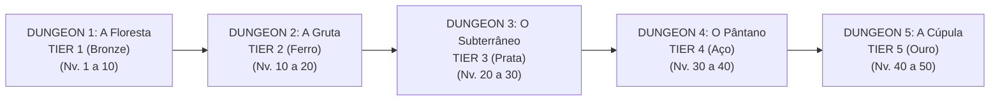

# PROGRESSÃO DO PRIMEIRO ATO: CICLO DAS 5 DUNGEONS (1 TIER POR DUNGEON)
> **Gênero:** RPG Co-op Dungeon Crawler / Roguelike de Ação  
> **Estilo Visual:** Fantasia medieval estilizada / Chibi Cartoon  
> **Motor Alvo:** Unreal Engine 5 (UE5)  
> **Regra de Tiers do Ato I:** Cada Dungeon corresponde estritamente a 1 Tier de Equipamento, Metal e Materiais.

---

## 🗺️ MAPA DE PROGRESSÃO GERAL DAS 5 DUNGEONS (ATO I)

> 📌 **Nota sobre os Tiers 6, 7 e 8 (Vermécio, Sombraço e Auralita):**  
> Ficam reservados para a expansão do **ATO II**, que expandirá a jornada além do nível 50 até o nível máximo.

---

## 🌲 DUNGEON 1: A FLORESTA (O REI GOBLIN)
* **Tier Exclusivo:** **TIER 1 — BRONZE** (Minérios de Cobre e Estanho, Madeira de Carvalho, Fibras Comuns).
* **Faixa de Nível:** Inicia no Nv. 1 (Progressão: Nv. 1 a 10).
* **Temática / Bioma:** Floresta medieval externa com árvores antigas, clareiras, pontes de madeira rústica, tocas de goblins e acampamentos improvisados.
* **Equipamentos Fabricáveis:** Armaduras e Armas de Bronze completo (Espadas, Adagas, Maças, Machados, Bestas de Madeira com pontas de Bronze).
* **Mobs e Inimigos:**
  - Goblin Soldado (Adaga e Porrete de madeira)
  - Goblin Arqueiro (Flechas curtas com ponta de osso/bronze)
  - Goblin Xamã (Projéteis tóxicos e totens tribais)
  - Lobo Selvagem e Javali da Floresta
* **Chefe do Bioma:** **Rei Goblin** (Portador de clava pesada de pedra e coroa tosca de bronze, com ataques de impacto em área e invocação de servos).
* **Coleta & Recursos:** Minério de Cobre, Minério de Estanho, Troncos de Carvalho, Ervas Medicinais Comuns.
* **Puzzles & Mecânicas:** Portões de madeira acionados por alavancas em acampamentos; tochas para queimar sarças que bloqueiam passagens secretas.

---

## 💧 DUNGEON 2: A GRUTA (A GRUTA DO ARCODRAGON)
* **Tier Exclusivo:** **TIER 2 — FERRO** (Minério de Ferro, Madeira de Teixo, Escamas Rígidas, Pérolas de Água Doce).
* **Faixa de Nível:** Inicia no Nv. 10 (Progressão: Nv. 10 a 20).
* **Temática / Bioma:** Caverna profunda com rios subterrâneos, cachoeiras, estalactites, fungos bioluminescentes e piscinas termais azuis.
* **Equipamentos Fabricáveis:** Armaduras e Armas de Ferro completo (Armadura pesada de placas de ferro, Escudos reforçados, Maças de ferro forjado).
* **Mobs e Inimigos:**
  - Morcego das Cavernas (Voo rasante, ataque sônico de atordoamento)
  - Lagarto Anfíbio das Sombras (Ataques rápidos de cauda e veneno leve)
  - Caranguejo de Carapaça Fóssil (Altíssima armadura frontal de carapaça)
  - Diabrete Aquático (Conjurador de orbes de água que reduzem velocidade)
* **Chefe do Bioma:** **Arcodragon (Dragão Aquático)** (Criatura ancestral serpenteante aquática que comanda correntes de água, jatos de alta pressão e submersão em arena alagada).
* **Coleta & Recursos:** Minério de Ferro, Cristais de Quartzo Azuis, Cogumelos Bioluminescentes, Algas Termais.
* **Puzzles & Mecânicas:** Drenagem de comportas de água para expor caminhos no fundo de lagos; pontes levadiças sobre corredeiras subterrâneas.

---

## 🏛️ DUNGEON 3: O SUBTERRÂNEO (A CIDADELA PERDIDA SUBTERRÂNEA)
* **Tier Exclusivo:** **TIER 3 — PRATA** (Minério de Prata, Mármore Rúnico, Madeira de Freixo, Resíduos Alquímicos Imperiais).
* **Faixa de Nível:** Inicia no Nv. 20 (Progressão: Nv. 20 a 30).
* **Temática / Bioma:** Ruínas arquitetônicas ciclópicas soterradas, antigas vias pavimentadas de pedra talhada imperial, colunatas rachadas, brasões esquecidos e câmaras de tesouro abandonadas.
* **Equipamentos Fabricáveis:** Armaduras e Armas de Prata completo (Lâminas reluzentes de prata gravadas, peitorais com alta resistência mágica).
* **Mobs e Inimigos:**
  - Guarda Esqueleto de Armadura de Prata Antiga (Escudo pesado e lança de estocada)
  - Autômato de Guarda Rachado (Gira com lâminas e solta vapor quente)
  - Espectro da Nobreza Soterrada (Projéteis espectrais de dreno de mana)
  - Golem de Entulho Arcano (Soco demolidor com tremor de terra)
* **Chefe do Bioma:** **O Guardião da Cidadela (Arquigolem Imperial / General Decaído)** (Armadura colossal com mecânica de absorção de dano que exige ativar pilares rúnicos para quebrar seu escudo).
* **Coleta & Recursos:** Minério de Prata, Fragmentos de Mármore Rúnico, Núcleos de Autômatos, Runas Antigas de Prata.
* **Puzzles & Mecânicas:** Placas de pressão no chão que devem ser ativadas em sincronia pela equipe; engrenagens giratórias para destrancar portões de bronze e prata maciça.

---

## 🌫️ DUNGEON 4: O PÂNTANO DA NÉVOA SOMBRIA
* **Tier Exclusivo:** **TIER 4 — AÇO** (Minério de Ferro Temperado / Carvão Mineral para Aço, Madeira de Salgueiro Negro, Venenos Concentrados).
* **Faixa de Nível:** Inicia no Nv. 30 (Progressão: Nv. 30 a 40).
* **Temática / Bioma:** Pântano tóxico e floresta inundada com águas lamacentas, árvores retorcidas cobertas de musgo fétido, ruínas semi-afundadas em mangues e névoa volumétrica rasteira.
* **Equipamentos Fabricáveis:** Armaduras e Armas de Aço temperado completo (Aço azulado ultra resistente, lâminas afiadas de combate profissional, bestas pesadas de aço).
* **Mobs e Inimigos:**
  - Serpente Constritora dos Charcos (Ataque surpresa debaixo da lama)
  - Bruxa do Pântano / Necromante dos Brejos (Maldições de lentidão e névoa corrosiva)
  - Zumbi Afogado do Lodazal (Inimigos resistentes que explodem em bile corrosiva ao morrer)
  - Fogo-Fátuo Ilusório (Drena estamina e atrai a equipe para armadilhas de lodo)
* **Chefe do Bioma:** **Matriarca dos Pântanos (Bruxa Ancestral / Besta do Lodazal)** (Controla áreas de lama que desaceleram e invoca clones espectrais na névoa espessa).
* **Coleta & Recursos:** Carvão Nobre e Matérias-Primas para Forja de Aço, Essências de Veneno, Flores Noturnas Raras, Madeira de Salgueiro.
* **Puzzles & Mecânicas:** Acender altares de fogo espectral para dissipar a névoa tóxica de cada setor; plataformas de madeira flutuantes que afundam com peso excessivo.

---

## ⚡ DUNGEON 5: A CÚPULA DOS VENTOS ANCESTRAIS (CLÍMAX DO ATO I)
* **Tier Exclusivo:** **TIER 5 — OURO** (Minério de Ouro Purificado, Madeira de Ébano Dourado, Plumas Místicas, Essências de Luz Solar).
* **Faixa de Nível:** Inicia no Nv. 40 (Progressão: Nv. 40 a 50 — Nível Máximo do Ato I).
* **Temática / Bioma:** Santuário colossal no cume de uma montanha flutuante acima das nuvens. Arquitetura celestial em pedra branca com adornos dourados reluzentes, colunatas suntuosas, pontes de luz e fortes correntes de vento.
* **Equipamentos Fabricáveis:** Armaduras e Armas de Ouro Imperial completo (Equipamento de elite do Ato I, ornamentado, altíssimo poder de atributos e foco crítico/mágico).
* **Mobs e Inimigos:**
  - Guardião Alado dos Ventos (Voo agressivo com rasantes em linha reta)
  - Sentinela de Ouro Imperial (Guerreiro mecânico dourado com sabres rápidos)
  - Conjurador da Tempestade Solar (Chama raios de luz direcionados e ciclones móveis)
  - Gárgula Dourada (Fica imóvel imune a dano e ataca de surpresa em momentos críticos)
* **Chefe do Bioma (Boss Final do Ato I):** **O Senhor dos Ventos Celestiais / Grão-Campeão Solar** (Batalha épica em 3 fases: Fase 1 Terrestre com cortes dourados rápidos; Fase 2 Aérea com bombardeio de raios e plataformas móveis no abismo; Fase 3 de Fúria Solar com tornados duplos e chuva de meteoros dourados).
* **Coleta & Recursos:** Veios Nobres de Minério de Ouro, Essências da Aurora, Fragmentos de Mármore Dourado, Plumas Celestes.
* **Puzzles & Mecânicas:** Espelhos solares que devem ser girados para refletir feixes de luz dourada em orbes rúnicos; correntes de ar ascendentes que projetam os jogadores para andares superiores sobre o abismo.
