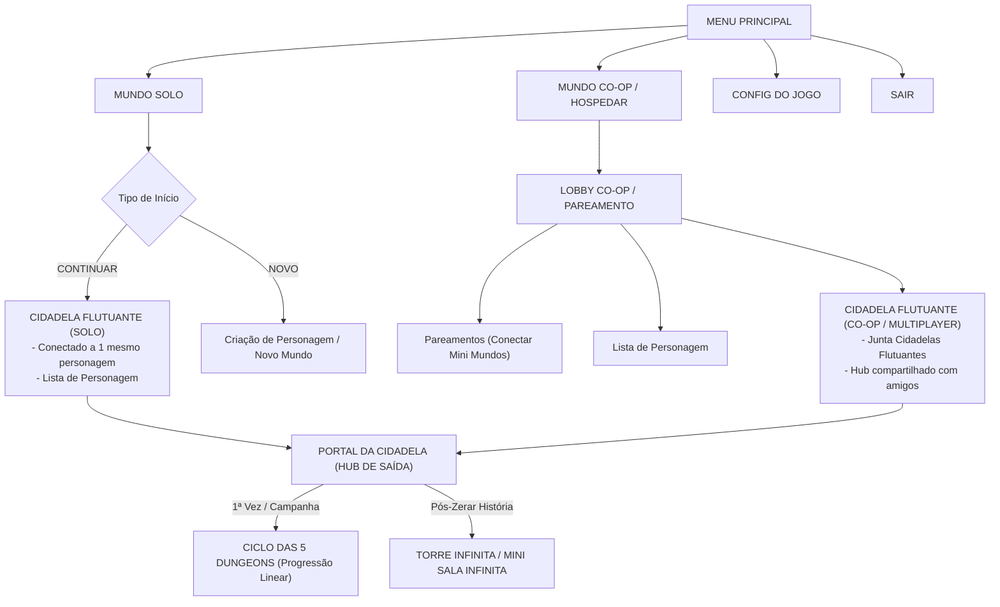

# FLUXO DE TELAS, NAVEGAÇÃO E GAMEPLAY (CIDADELA FLUTUANTE)
> **Origem dos Dados:** Transcrição completa e estruturação das anotações manuscritas (`E:\The_Pixel\docs\prints\`).  
> **Motor Alvo:** Unreal Engine 5 (UE5) · CommonUI + Enhanced Input + GAS.

---

## 1. FLUXO GERAL DE NAVEGAÇÃO (DO MENU AO INÍCIO DA RUN)

---

## 2. A CIDADELA FLUTUANTE (HUB DO JOGADOR)

A Cidadela Flutuante funciona como a base de operações persistente do jogador no jogo, servindo tanto para sessões solo quanto agrupadas no multiplayer.

### 2.1 Meu Mini Mundo (Instância Pessoal)
- **Terreno Modular Diamantado:** Base de blocos modulares flutuantes personalizáveis.
- **Estruturas e Slots Alocáveis:**
  - **Casa do Jogador:** Ponto de descanso, baú pessoal e personalização cosmética.
  - **Loja do Jogador:** Exposição de itens craftados e troca comercial.
  - **Estações de Atividades / Crafting:** Bancadas de forja, moagem, alquimia e culinária.
  - **Área Pessoal Editável:** Espaço livre para expansão e decoração.

### 2.2 Junta Cidadelas Flutuantes (Rede e Multiplayer)
- No modo Co-op, as cidadelas flutuantes dos jogadores do esquadrão se conectam magneticamente por pontes de energia/pedra flutuante.
- Cada membro da party pode circular pela cidadela do amigo, usar serviços de crafting e se reunir no portal central.

### 2.3 O Portal da Cidadela (Interface de Saída para Dungeons)
Ao interagir com o grande Portal de Pedra no centro da Cidadela:
1. **Pareamento:** Convidar amigos da lista Steam/Epic ou abrir vaga para busca de grupo.
2. **Configuração da Dungeon:**
   - Selecionar bioma disponível.
   - Definir nível de dificuldade / Tormento.
   - Conferir se todos os membros estão prontos.
3. **Postar Lobby no Chat Geral:** Envia link de entrada direta na party para outros jogadores.
4. **Entrar:** Transiciona a equipe para a dungeon selecionada.

---

## 3. REGRA DO PORTAL & CICLO DE HISTÓRIA VS. ENDGAME

### 3.1 Primeira Vez (Modo História / Campanha Co-op)
- O portal **sai do chão** ao concluir a dungeon anterior, recompensando o jogador com acesso permanente ao próximo bioma.
- **Checkpoints e Salve de Acesso:** O jogador que completa o bioma recebe a possibilidade de acesso quando quiser através da Cidadela (atalho rápido).
- **Regra de Grupo (Party Check):** Se ao menos um membro do esquadrão não tiver concluído a história, todos entram juntos no modo campanha co-op no ponto do jogador com menor progresso.

### 3.2 Após "Zerar" o Modo História (Modo Infinito)
- O portal passa a permitir acesso à **Torre Infinita / Mini Sala Infinita**:
  - Puzzles gerados com pistas do bioma.
  - Uso prático de habilidades de crafting em tempo de run.
  - Combate escalonado contra Mobs e Monstros Chefes.

---

## 4. O SISTEMA DA PEDRA DE TELEPORTE (TP) & MECÂNICA DE MANA
*(Inspirado no sistema de Incenso e Atração do Pokémon)*

Para criar risco e recompensa no avanço das dungeons e da Torre Infinita:

| Tipo | Uso | Consumo / Dificuldade | Risco / Penalidade |
| :--- | :--- | :--- | :--- |
| **Pedra de TP Pequena (1 Pessoa)** | Usada em área segura do andar pelo jogador solo | **Decaimento de Mana igual radiação:** vazão contínua por minuto/hora. Ao ativar, aumenta a dificuldade chamando monstros de tiers mais altos (+X níveis). | **TP Arriscado:** Desarme temporal; em caso de falha ou morte antes do teleporte, há perda de itens selecionados da mochila. |
| **Pedra de TP / Altar em Equipe** | Mini altar físico fincado no chão para a party inteira | Vazão de mana escalonada por minuto/hora para todo o esquadrão. Ativação visual com barra de progresso e estatísticas no menu do andar. | Defesa obrigatória do Altar contra ondas até a conclusão do feitiço. |
